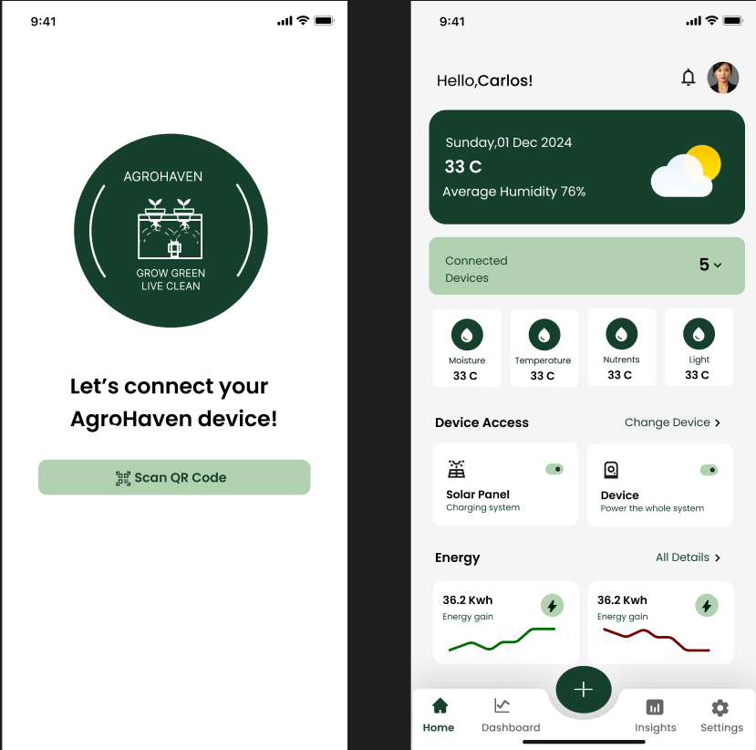

# Ihimbazwe Niyikora Kevine — Portfolio Website

A modern, high-end, clean, interactive personal portfolio website for **Ihimbazwe Niyikora Kevine** — Software Engineer, AI & Data Enthusiast, Builder, and Designer.



## 🚀 Features

- **Dynamic Hero Section**: Headline, short introduction, CTA buttons, and interactive floating technology cards.
- **Concise About Section**: Interactive visual focus cards across practical tech, AI & data, mobile, IoT aeroponics, UI/UX design, and social impact.
- **Flagship Featured Section**: Standout spotlight cards for top flagship projects (AgroHaven, JetOpinion, TalkForward, EchoMirror).
- **Multi-Category Project Showcase**: Filterable gallery across 9 domains with multi-category mapping per project.
- **Interactive Case Study Modal**: Detailed popup displaying problem, solution, key features list, tech stack, role, impact, and editable link placeholders.
- **Categorized Tech Stack**: Grouped interactive technology cards including Cyberium cybersecurity training certificate highlights.
- **Visual Journey Timeline**: Track education, software innovations, certifications, and leadership milestones.
- **Contact & Feedback**: Form with instant feedback, direct email copy action, and social profile links.
- **Vercel Ready**: Built with Vite + React + Tailwind CSS v4 for zero-config instant Vercel deployment.

---

## 📁 How to Customize Projects & Information

All website content is driven by a single modular JavaScript data file:
```
src/data/portfolioData.js
```

### 1. Update Personal Links & Contact
Open `src/data/portfolioData.js` and edit the `personalInfo` object:
```javascript
export const personalInfo = {
  name: "Ihimbazwe Niyikora Kevine",
  email: "your-real-email@domain.com",
  github: "https://github.com/your-github",
  linkedin: "https://linkedin.com/in/your-linkedin",
  figma: "https://figma.com/@your-figma",
  // ...
};
```

### 2. Add or Edit Projects & URLs
Each project inside `projectsData` contains simple editable fields for URLs:
```javascript
{
  id: "jetopinion",
  title: "JetOpinion",
  links: {
    liveDemo: "https://your-live-demo-link.vercel.app",
    github: "https://github.com/KevineNiyikora/JetOpinion",
    figma: "https://figma.com/file/your-figma-link",
    caseStudy: "https://medium.com/@your-case-study"
  }
}
```

---

## 🛠️ Local Development Commands

### Install Dependencies
```bash
npm install
```

### Run Dev Server
```bash
npm run dev
```
Open `http://localhost:5173` in your browser.

### Build Production Bundle
```bash
npm run build
```

---

## ⚡ Deployment to Vercel

This project is fully optimized for Vercel deployment.

### Option A: Deploy via GitHub (Recommended)
1. Push this codebase to a GitHub repository.
2. Go to [Vercel Dashboard](https://vercel.com/new).
3. Import your GitHub repository.
4. Framework Preset will automatically detect **Vite**.
5. Click **Deploy**.

### Option B: Deploy via Vercel CLI
```bash
npm install -g vercel
vercel
```
